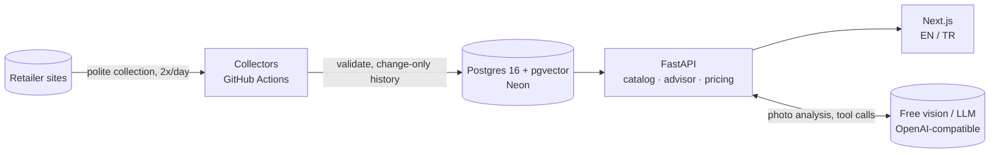

# RealDrop

**Your AI fashion advisor, with honest prices.** Pick your style (old money, streetwear, minimal,
...), upload an outfit you saw on Instagram or Pinterest, and RealDrop finds each piece across Turkish
fashion brands, builds outfits around your taste, and shows what every discount **really** is, based
on prices recorded every day.

[](https://github.com/AhmedElghazzawy/realdrop/actions/workflows/ci.yml)
[](https://github.com/AhmedElghazzawy/realdrop/actions/workflows/collect.yml)


-black?logo=ollama&logoColor=white)


> **Built in public.** Started 24 Oct 2026, launching on Black Friday, 27 Nov 2026.
> Follow the commits and the [roadmap](docs/product/roadmap.md).

## What it does

| | Feature | Status |
|---|---|---|
| 📸 | **Shop the look:** upload a photo, get matching pieces from every brand, in your size and budget | Phase 7 |
| 🧭 | **Style profile:** choose your styles, fits, colours and budget once; everything is ranked by it | Phase 6 |
| 👔 | **Outfit boards:** complete looks built around a piece or an occasion, with a total price | Phase 8 |
| 💬 | **Stylist chat:** "old money outfit for a wedding under 4,000 TL" | Phase 9 |
| 📉 | **Honest prices:** daily price history, real-discount labels, inflated "original" prices flagged | Live (data since 24 Oct) |
| 🏷️ | **11 brands collected twice a day:** DeFacto, Koton, Colin's, Mudo, GAP, M&S, Damat Tween, Les Benjamins, Lufian, TommyLife, Hatemoğlu | Live |

Use cases and acceptance criteria: [`docs/product/use-cases.md`](docs/product/use-cases.md).

## Progress

| Phase | Focus | Status |
|---|---|---|
| 1 | Environment, free/open-source models | ✅ Done |
| 2 | Backend foundation: database schema, `/health`, collector base | ✅ Done |
| 3 | First brand collecting daily on a server | ✅ Done |
| 4 | More brands, price roll-ups, real-drop rule | 🟡 In progress (11 brands) |
| 5 | Catalog understanding: style tags, attributes, semantic search | 🟡 Next |
| 6 | Style profile onboarding and "For you" feed | ⚪ Planned |
| 7 | Shop the look: photo to matching products across brands | ⚪ Planned |
| 8 | Advisor redesign: outfit boards, modern mobile-first UI | ⚪ Planned |
| 9 | AI stylist chat and "Complete the look" | ⚪ Planned |
| 10 | Black Friday page, KVKK, hardening, launch | ⚪ Planned |

## Architecture



- **Backend:** Python 3.12, FastAPI, SQLAlchemy 2 (async), Pydantic v2, Alembic
- **Data:** PostgreSQL 16 + pgvector: relational, full-text and vectors in one database
- **AI:** free and open models only (Ollama locally, free API tiers in production), hand-written
  tool loop, no agent frameworks; every AI feature gated by evals
- **Frontend:** Next.js 16 (App Router), React 19, TypeScript, Tailwind 4; English and Turkish
- **Ops:** GitHub Actions (CI + collection), Neon, Render, Vercel: all free, no card

Details: [architecture overview](docs/architecture/overview.md) (C4 diagrams, layers, flows) and
[decision records](docs/architecture/decisions/README.md).

## Engineering principles

1. **The AI never invents prices.** Discounts are computed in code from stored history; any AI
   text with numbers passes a grounding guard ([ADR 0004](docs/architecture/decisions/0004-code-computes-prices.md)).
2. **Every AI feature ships with evals.** No eval, not done.
3. **Enforced architecture.** A layered dependency rule, checked by tests on every push.
4. **Honest about limits.** No real-discount claim under 14 days of data; matches are "similar", not "the same".
5. **Polite collection.** robots.txt and terms respected, identified User-Agent, rate limits, stop on 403.
6. **Privacy by default.** No accounts at launch; the style profile stays on the device; photos are never stored.

## Quick start

Requires Docker, [uv](https://docs.astral.sh/uv/), Node 24 and pnpm.

```bash
cp .env.example .env
make setup && make up && make migrate
make api      # http://localhost:8010/docs
make web      # http://localhost:3000
make check    # lint, types, tests, build
```

Full guide: [`docs/engineering/setup.md`](docs/engineering/setup.md). How to contribute:
[`CONTRIBUTING.md`](CONTRIBUTING.md).

## Repository layout

```
apps/api/              FastAPI backend, collectors and batch jobs (Python package `realdrop`)
  src/realdrop/        api/ services/ pricing/ pipeline/ collectors/ models/ schemas/ db/
  tests/               mirrors src/, plus architecture rules
  alembic/             database migrations
apps/web/              Next.js frontend (English + Turkish)
docs/                  product/ architecture/ engineering/ operations/ data-sources/
evals/                 golden sets for the AI components
infra/                 database init scripts
.github/               CI, scheduled collection, Dependabot, PR and issue templates
Makefile               one entry point for everyday tasks (`make help`)
```

Documentation index: [`docs/README.md`](docs/README.md).

## Built with Claude Code

This repo is built together with [Claude Code](https://claude.com/claude-code). `CLAUDE.md` and
`.claude/` hold the rules, specialist agents (architect, reviewer, collector, search/ML, frontend)
and step-by-step skills it follows.

## Author

**Ahmed Elghazzawy** ([@AhmedElghazzawy](https://github.com/AhmedElghazzawy)), a computer-engineering
student building this to learn and ship. Focus: AI engineering (structured extraction, hybrid search,
tool-calling agents, evals).

## License

Copyright © 2026 Ahmed Elghazzawy. All rights reserved. The source is public to view and learn from;
no license is granted to reuse it yet.

Price data shown by the app belongs to the respective retailers; brand names are their owners'
trademarks. RealDrop is not affiliated with any retailer.
