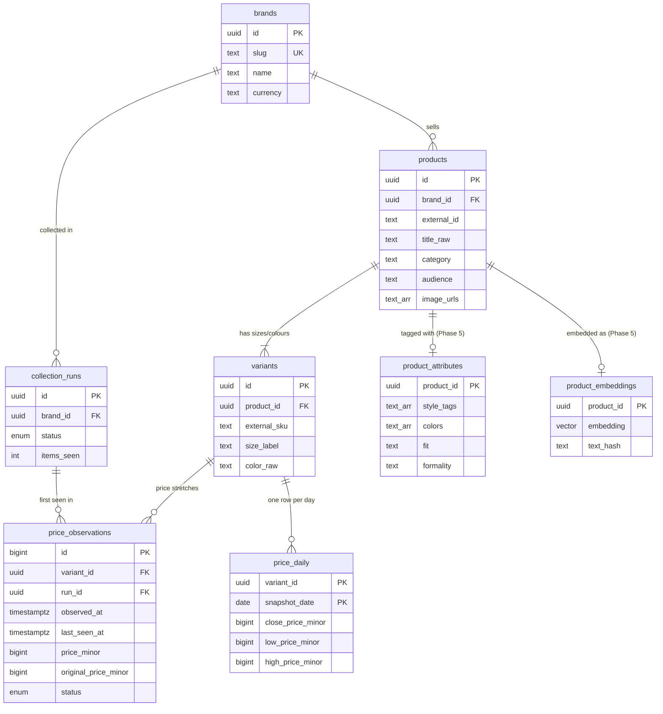

# Data model

The schema is built only by Alembic migrations (`apps/api/alembic/versions/`); this document must
match them. Changing it needs an ADR when it changes a decision (e.g. [ADR 0006](decisions/0006-append-only-observations.md)).

## Conventions

| Topic | Rule |
|---|---|
| Keys | UUID primary keys from `gen_random_uuid()`; `bigserial` only for high-volume append tables |
| Time | `timestamptz` in UTC; a price's "day" (`snapshot_date`) is the `Europe/Istanbul` calendar date |
| Money | Integer minor units (`*_minor`, `bigint`, kuruş), a `currency` column next to every price ([ADR 0007](decisions/0007-integer-minor-units.md)) |
| History | Catalog and price rows are never deleted (`is_active = false` instead); every FK to them is `ON DELETE RESTRICT` |
| Naming | Tables plural snake_case; constraints named by the metadata naming convention (`pk_`, `fk_`, `uq_`, `ck_`, `ix_`) |
| Derived data | Tables computed from others (`price_daily`, attributes, embeddings) can be rebuilt from their sources at any time |
| Text | Turkish-safe normalisation (NFC, `tr_lower`) before hashing or matching |

## Entity relationships

Implemented (solid) and planned for launch (Phase 5).

## Implemented tables

### Catalog

- **brands**: `id`, `slug` (unique), `name`, `country` (default `TR`), `currency` (default `TRY`),
  `base_url`, `is_active`, `collector_config` (jsonb).
- **products**: `id`, `brand_id` FK, `external_id`, `url`, `title_raw`, `description_raw`,
  `image_urls` (text[], hotlinked), `category_raw`, `audience` (`men` | `women` | NULL, as the shop
  says), `category` (ours, one of the 15 in `pipeline/categorize.py`, set by keyword rules on every
  sighting; NULL when no rule matches), `content_hash`, `first_seen_at`, `last_seen_at`,
  `is_active`. Unique `(brand_id, external_id)`.
- **variants**: `id`, `product_id` FK, `external_sku`, `size_label`, `size_normalized`, `color_raw`,
  `color_normalized`. Unique `(product_id, external_sku)`.

### Prices

- **collection_runs**: `id`, `brand_id`, `started_at`, `finished_at`,
  `status` enum(`running`,`succeeded`,`partial`,`failed`), `items_seen`, `items_failed`, `notes`.
  `partial` = finished with some items failed; `failed` = stopped early (403, robots.txt, gave up).
- **price_observations** (change-only stretches): `id` bigserial, `variant_id` FK, `run_id` FK (the
  run that first saw it), `observed_at` (first seen), `last_seen_at` (latest run that saw it),
  `price_minor`, `original_price_minor` (nullable, what the retailer claims as the old price),
  `currency`, `in_stock`, `status` enum(`confirmed`,`pending`,`rejected`), `reject_reason`.
  Index `(variant_id, observed_at)`; CHECK `last_seen_at >= observed_at`. No CHECK on the price:
  impossible prices are stored as `rejected` with a reason so the glitch filter stays auditable.
  **One row per unchanged state**, not per run (owner decision, 25 Oct 2026, to fit 3-6 brands in
  Neon's free 0.5 GB): a run that sees the same price, claimed original, stock and currency as the
  variant's latest row only moves `last_seen_at`; any change adds a row. A `rejected` latest row is
  never extended; the next sighting is judged afresh. Merging the per-run rows of 24-25 Oct turned
  6,672 rows into 6,130.
- **price_daily** (derived, `pipeline/rollup.py`): `variant_id`, `snapshot_date`, `close_price_minor`
  (last confirmed of the day), `low_price_minor`, `high_price_minor`, `claimed_original_minor`,
  `currency`, `in_stock_close`. PK `(variant_id, snapshot_date)`. CHECK `low > 0` and
  `low <= close <= high`. A confirmed stretch covers every Istanbul day from `observed_at` to
  `last_seen_at`. Every run rebuilds the last 7 days (`ROLLUP_LOOKBACK`) for the variants it saw.
- **current_prices**: deferred (not built). Catalog queries compute the latest confirmed price per
  variant directly and are fast enough; add a table or materialized view only when a query
  measurably needs it.

## Planned for launch (Phase 5)

- **product_attributes** (derived; rebuilt when `content_hash` or `tagger_version` changes):
  `product_id` PK/FK, `style_tags` (text[], from the style vocabulary: `old_money`, `streetwear`,
  `minimal`, `smart_casual`, `classic_tailoring`, `techwear`, `workwear`, `preppy`, `sporty`, `y2k`),
  `subcategory`, `colors` (text[], canonical), `pattern`, `fit`, `material` (text[]), `formality`
  (`casual` | `smart_casual` | `formal`), `season` (text[]), `occasion` (text[]), `source`
  (`rules` | `llm`), `confidence` (jsonb per field), `tagger_version`, `tagged_at`.
  GIN indexes on `style_tags` and `colors`.
- **product_embeddings** (derived): `product_id` PK/FK, `model`, `embedding` (`halfvec` or a reduced
  dimension to fit Neon's 0.5 GB; decided in Phase 5), `text_hash`, `created_at`. HNSW index,
  cosine distance.
- **llm_calls** (operations): `id`, `purpose` (`tagger` | `look` | `stylist`), `provider`, `model`,
  `input_tokens`, `output_tokens`, `latency_ms`, `status` (`ok` | `invalid` | `rate_limited` |
  `error`), `created_at`. No prompt text, no images, no personal data.

No user tables at launch: the style profile lives on the device ([ADR 0014](decisions/0014-style-profile-on-device.md)),
and uploaded photos are never stored ([ADR 0015](decisions/0015-shop-the-look-via-vision-model.md)).

## After launch

`users` (optional login to sync, UC-10), `wardrobe_items` (UC-09), `saved_outfits`, `alerts` and
`alert_events` (UC-12). Each arrives with its own migration, KVKK review (consent, export, delete)
and an update to this document.

## Glitch filter (`pipeline/validate.py`)

Applies to each new observation. Defaults live in `pricing/config.py` and are covered by tests.

1. **Reject** if `price_minor <= 0` or `price_minor < MIN_PRICE_MINOR` (default 500, i.e. 5 TRY).
2. **Hold as `pending`** if the price differs from the last confirmed price by `>= 70%`, or is below
   `20%` of the 30-day median, or `original_price_minor < price_minor` (impossible claim).
3. A pending observation becomes **`confirmed`** when a later run sees the same state again at least
   30 minutes after it was first seen (its stretch is extended, see `price_observations`).
4. A pending observation not confirmed within **48 hours** becomes `rejected` (reason logged).
5. Only `confirmed` observations feed `price_daily`, the real-drop rule and alerts.

## Real-drop rule (`pricing/real_drop.py`)

For a variant on day `t`, with `P_t` the confirmed close price:

- **History** `H` = confirmed daily close prices for days `t-30 ... t-1` on which the variant was tracked.
- If `len(H) < MIN_HISTORY_DAYS` (default 14): status = `insufficient_history`. **No real-discount claim.**
  The UI shows "tracking since <date>".
- `reference = median(H)` (the median resists one-day spikes and one-day dips).
- `real_discount_pct = (reference - P_t) / reference`.
- `claimed_discount_pct = (claimed_original - P_t) / claimed_original` when a claimed original exists.

Status (exactly one):

| Status | Condition |
|---|---|
| `real_drop` | `real_discount_pct >= 0.10` and `P_t <= min(last 7 days of H)` and in stock |
| `small_drop` | `0.03 <= real_discount_pct < 0.10` |
| `normal` | `-0.03 < real_discount_pct < 0.03` |
| `price_up` | `real_discount_pct <= -0.03` |
| `insufficient_history` | see above |

A drop of 10% or more that fails the 7-day-low or in-stock check is `small_drop`: we only say "real
drop" when all three conditions hold. With no tracked day in the last 7, the 7-day-low check fails.

Flags (independent):

- `claim_inflated`: `claimed_discount_pct >= 0.20` and `claimed_discount_pct - real_discount_pct >= 0.15`.
- `all_time_low`: `P_t <= min(all confirmed daily closes)` with at least `MIN_HISTORY_DAYS` of history.

Known limitations (document them in the UI where relevant): gradual end-of-season markdowns lag behind
the 30-day median; before 30 days of history exist the window is `min(30, available)`; a retailer that
raises the price for a few days and then "discounts" is only caught if the raise happened after we
started tracking.

All thresholds are config, and the rule is pure functions over a price series, so it is easy to test:
median robust to a single spike, monotonic in price, no claim under 14 days, flags independent of status.

## Alert rule (after launch, UC-12)

When a new **confirmed** price arrives for a variant, for each active alert on that product:

1. Skip if the variant is out of stock, or the alert has a size and it does not match this variant.
2. Fire if `price <= target_price_minor`, **or** if status is `real_drop` and
   `real_discount_pct >= min_real_discount_pct`.
3. Skip if `now < cooldown_until`, or `price == last_notified_price_minor`.
4. On fire: send, write `alert_events`, set `cooldown_until = now + 24h`, store `last_notified_price_minor`.
5. Per-user cap: at most 5 alert messages per day; extra matches go into a single digest message.

Alerts never reference a price that is not in `price_observations` as `confirmed`.
