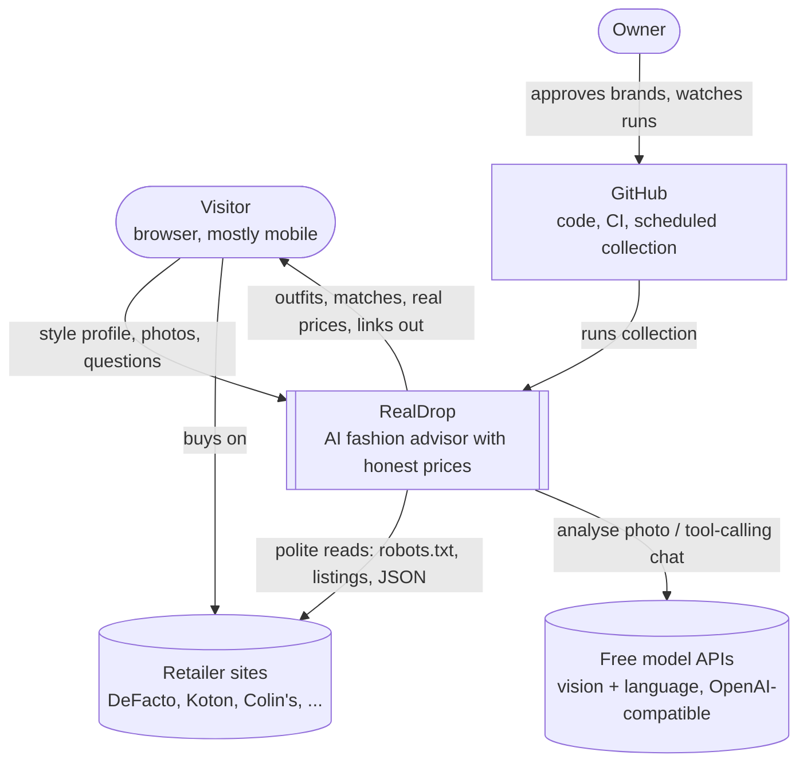
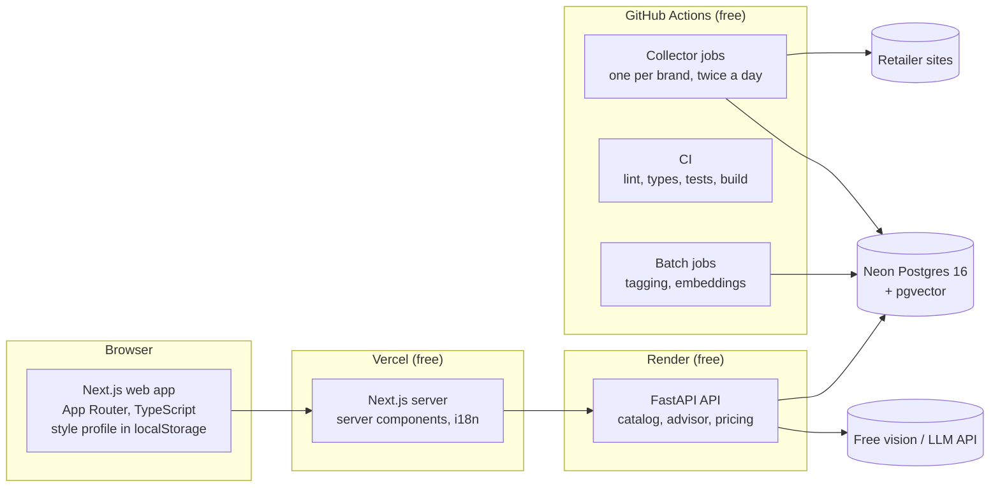
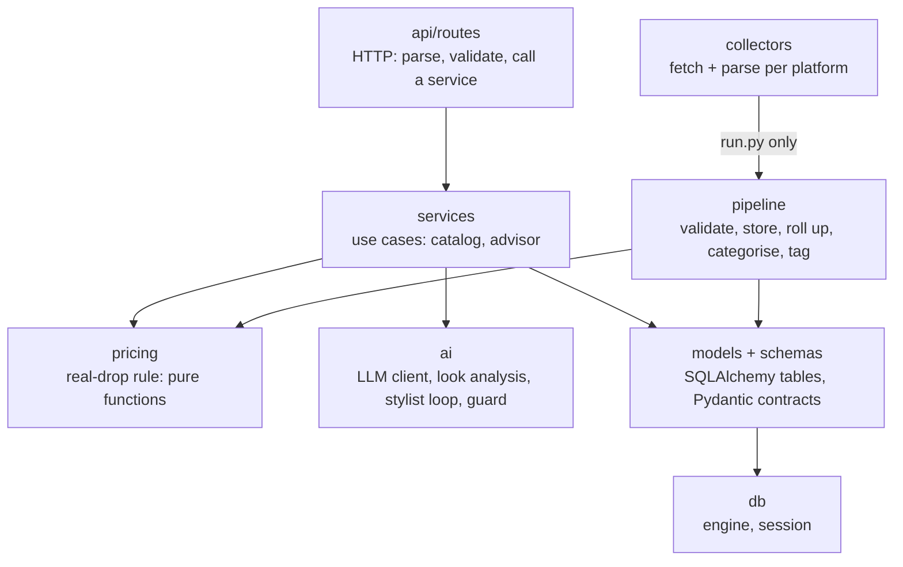
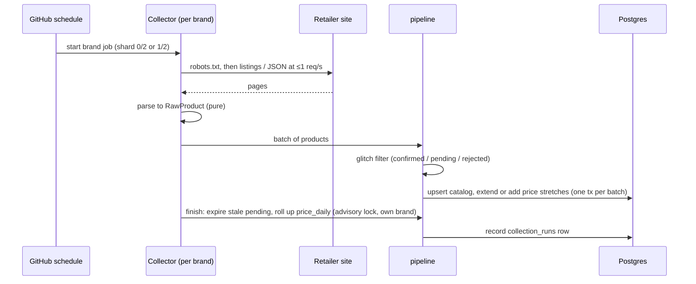

# Architecture overview

How RealDrop is built, why, and which rules keep it that way. Diagrams follow the
[C4 model](https://c4model.com) (context, then containers, then components). Decisions are recorded
as ADRs in [`decisions/`](decisions/README.md).

## 1. System context



## 2. Containers



| Container | Tech | Responsibility |
|---|---|---|
| Web | Next.js 16, React 19, Tailwind 4 | UI in English and Turkish; keeps the style profile on the device |
| API | Python 3.12, FastAPI, SQLAlchemy 2 async, Pydantic v2 | Catalog queries, real-discount status, shop the look, outfits, stylist |
| Collector | Same Python package, `python -m realdrop.collectors.run` | Read retailer catalogs politely, validate, store, roll up |
| Batch jobs | Same package; local Ollama or GitHub Actions | Tag products with attributes and style tags; compute embeddings |
| Database | Neon Postgres 16 + pgvector | Catalog, price history, attributes, embeddings: one store for relational, full-text and vector queries |

One Python package serves the API, the collectors and the batch jobs, so domain code (pricing,
categories, attributes) exists once.

## 3. Components and layers (API package `realdrop`)



**The dependency rule.** Arrows point the only way imports may go. Enforced by
`apps/api/tests/test_architecture.py`:

| Rule | Why |
|---|---|
| `pricing` imports nothing but itself | Money logic must be pure and exhaustively testable; trust is the product |
| Parsers (`collectors/*/parser.py`, `money`, `sitemap`, `robots`) do no IO | Each retailer's markup is tested against saved fixtures, offline |
| Collectors do not touch storage, except the `run` entry point | Fetching and storing fail differently and are tested separately |
| Routes call services; no SQL, models or pipeline in routes | HTTP stays a thin adapter; the same use case can be called by the stylist's tools |
| Only `api` knows FastAPI | Services, pipeline and pricing run in jobs and tests without a web server |
| Models, schemas and `db` do not depend on behaviour | Data definitions stay stable while features change |

Planned package additions follow the same rule: `ai/` (LLM client, look analysis, stylist loop,
number-grounding guard), `services/advisor.py` (shop the look, outfits, feed ranking),
`pipeline/attributes.py` (rule-based tagging).

## 4. Key flows

### 4.1 Collection (UC-08)



### 4.2 Shop the look (UC-02)

```mermaid
sequenceDiagram
  participant B as Browser
  participant A as API
  participant V as Vision model
  participant DB as Postgres
  B->>A: POST /advisor/looks (image, profile: sizes, budget, styles)
  A->>V: image + schema prompt (JSON output)
  V-->>A: pieces [{category, colours, pattern, fit, style_tags, confidence}]
  A->>A: validate with Pydantic; retry once; drop low-confidence pieces
  loop each piece
    A->>DB: attribute filters + semantic search, in stock, sizes, budget
    DB-->>A: candidates
    A->>A: rank (attribute match, profile fit), attach real-discount status from pricing
  end
  A-->>B: pieces with up to 5 matches each
  Note over A: the image is never stored
```

### 4.3 Request path for a product page (UC-06)

Browser → Next.js server component → `GET /products/{id}` → `services.catalog` loads product,
variants and `price_daily` → `pricing.real_drop` computes status → response schema → page.

## 5. Quality attributes

| Attribute | Approach |
|---|---|
| **Correctness of money** | Integer minor units; prices only from confirmed observations; discounts only from `pricing/`; LLM output with numbers passes the grounding guard |
| **Testability** | Pure parsers and pricing; DB tests on real migrations inside a rolled-back transaction; network blocked in tests; architecture rules as tests |
| **Reliability** | Collection runs per brand, isolated; a failed brand never blocks others; batches commit independently; every run is recorded |
| **Graceful degradation** | Model down: shop the look says so; feed and search still work. Brand down: last data is served with an honest "as of" |
| **Privacy (KVKK)** | No accounts at launch; profile on device; photos not stored; no personal data in prompts or logs |
| **Cost** | Free tiers only ([ADR 0011](decisions/0011-free-models-only.md), [ADR 0012](decisions/0012-no-card-free-tier-hosting.md)); rate limits on AI endpoints protect quotas |
| **Politeness** | robots.txt, identifying User-Agent, ≤1 request start per second, back off on 429, stop on 403 |

## 6. Environments

| | Development | Production |
|---|---|---|
| Database | Docker `pgvector/pgvector:pg16` (`make up`) | Neon free (0.5 GB), Frankfurt |
| API | `make api` (port 8010) | Render free web service (when the advisor ships) |
| Web | `make web` (port 3000) | Vercel free |
| Collection | `make collect-dry BRAND=...` | GitHub Actions `collect.yml` |
| Models | Ollama (`gemma4:12b`) | Free API tier chosen by evals |
| CI | `make check` | GitHub Actions `ci.yml` on every push and PR |

Configuration comes from environment variables only (`apps/api/src/realdrop/config.py`;
template in `.env.example`). Secrets live in GitHub/Render/Vercel secret stores, never in the repo.

## 7. Capacity (launch)

About 11 brands × ~5,000 men's products × ~5 variants ≈ 275k variants. Change-only observations
([ADR 0006](decisions/0006-append-only-observations.md)) keep growth to rows that actually changed;
prod used ~40 MB of 512 MB on 26 Oct. Embeddings: 55k products × 1024 floats ≈ 225 MB as `vector`,
too much for the free tier, so we embed with a smaller dimension or `halfvec` (decided in Phase 5).
Watch item: Neon storage in the console weekly.
