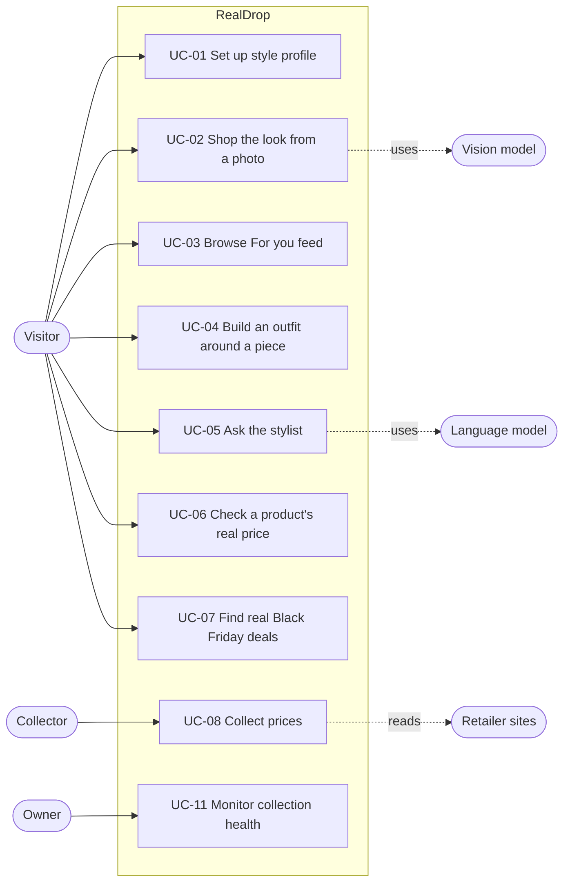

# Use cases

Each use case has an id (UC-nn) that issues, PRs and tests refer to. Actors, the main success
scenario, the important alternatives, and acceptance criteria that can be checked.

## Actors

| Actor | Description |
|---|---|
| **Visitor** | Anyone using the site. No account at launch; their style profile lives in their browser |
| **Collector** | Scheduled job on GitHub Actions that records prices from retailer sites |
| **Owner** | Runs the project: approves brands, watches collection health, answers incidents |
| **Retailer site** | External system we read from (politely) and link out to |
| **Vision / language model** | External free-tier model behind an OpenAI-compatible API |

## Launch use cases

### UC-01 Set up a style profile

- **Actor:** Visitor. **Trigger:** first visit, or "Edit my style".
- **Main scenario:**
  1. The visitor picks 1-3 styles from mood images (old money, streetwear, minimal, smart casual,
     classic tailoring, techwear, workwear, preppy, sporty, Y2K).
  2. Picks preferred fits (slim, regular, relaxed, oversize), colours they like and avoid.
  3. Sets sizes (tops, bottoms, shoes) and a budget per piece.
  4. Optionally picks favourite brands.
  5. The system saves the profile in the browser and shows the "For you" feed.
- **Alternatives:** skip at any step (defaults: no style filter, all sizes, no budget). Edit or
  reset at any time from the profile page.
- **Acceptance:** the profile survives a reload; nothing is sent to the server except as query
  parameters of the requests that need it; "Reset" clears it completely.

### UC-02 Shop the look from a photo

- **Actor:** Visitor. **Trigger:** uploads or pastes an image (screenshot from Instagram, Pinterest,
  TikTok, or a photo).
- **Main scenario:**
  1. The system checks the file (type, size <= 8 MB) and sends it to the vision model.
  2. The model returns the pieces it sees, each in our attribute schema (category, colours,
     pattern, fit, material, style tags) with a confidence.
  3. For each piece, the system searches the catalog with those attributes, filtered by the
     visitor's sizes and budget, and returns up to 5 matches across brands.
  4. The visitor sees the photo with the pieces listed, and per piece the matches with price, real
     discount label and brand. They can switch a piece to "cheaper alternatives".
- **Alternatives:**
  - No clothing found: say so and suggest a clearer photo.
  - Model unavailable or rate-limited: say so honestly; never fake results.
  - No match within budget: show the closest matches and label them "over your budget".
- **Acceptance:** the photo is not stored anywhere; every price shown comes from our database; p95
  under 8 s; piece-detection and match-relevance evals meet their thresholds.

### UC-03 Browse the "For you" feed

- **Actor:** Visitor with a profile. **Main scenario:** the feed shows in-stock products in their
  sizes, ranked by profile match with diversity (not ten identical shirts), each with a "because you
  like old money" reason. "Not my style" hides an item and nudges the ranking.
- **Acceptance:** ranking is deterministic for the same profile and catalog; every item has a reason.

### UC-04 Build an outfit around a piece

- **Actor:** Visitor. **Trigger:** "Complete the look" on a product page or a shop-the-look match.
- **Main scenario:** the system proposes 2-3 outfit boards (top, bottom, shoes, optional layer and
  accessory) that fit the anchor piece's style and the visitor's profile, with a total price. Any
  slot can be swapped for alternatives.
- **Acceptance:** all pieces are in stock in the visitor's sizes; the total equals the sum of shown
  prices.

### UC-05 Ask the stylist (Should)

- **Actor:** Visitor. **Trigger:** types a request, e.g. "old money outfit for a wedding under
  4,000 TL", "what goes with grey chinos?".
- **Main scenario:** the language model calls our catalog tools, then answers briefly with outfit
  boards rendered by the UI.
- **Acceptance:** zero prices or discounts in the answer that did not come from a tool
  (number-grounding guard); prompt-injection eval cases pass.

### UC-06 Check a product's real price

- **Actor:** Visitor. **Main scenario:** the product page shows the price chart, sizes in stock, the
  retailer's claimed discount and our real-discount status ("real drop", "normal price", "claim
  inflated", or "tracking since <date>"), and links out to the retailer.
- **Acceptance:** follows the real-drop rule in
  [`../architecture/data-model.md`](../architecture/data-model.md); no claim under 14 days of data.

### UC-07 Find real Black Friday deals (Should)

- **Actor:** Visitor. **Main scenario:** a page lists products with a confirmed real drop, filterable
  by style and size, plus examples of inflated claims.

### UC-08 Collect prices

- **Actor:** Collector (scheduled twice a day, every 4 h before the sale).
- **Main scenario:** per brand in parallel: check robots.txt, read the catalog politely, validate
  each price (glitch filter), store change-only observations, roll up daily prices, record the run.
- **Alternatives:** 403 or robots disallow stops the brand's run and records why; repeated 5xx skips
  pages, then stops.
- **Acceptance:** every run, including failed ones, is recorded in `collection_runs`; runs of
  different brands never corrupt each other's data.

### UC-11 Monitor collection health

- **Actor:** Owner. **Main scenario:** the status page and the workflow history show the latest run
  per brand, success rate and product counts; the runbook says what to do per failure type
  ([`../operations/runbook.md`](../operations/runbook.md)).

## After launch

| Id | Use case | Summary |
|---|---|---|
| UC-09 | My wardrobe | Save pieces you own (from the catalog or a photo) and get outfits that mix owned and new pieces |
| UC-10 | Sync my profile | Optional email login so the profile, wardrobe and saved outfits follow the visitor across devices |
| UC-12 | Price alerts | Get notified when a saved product drops for real in your size |
